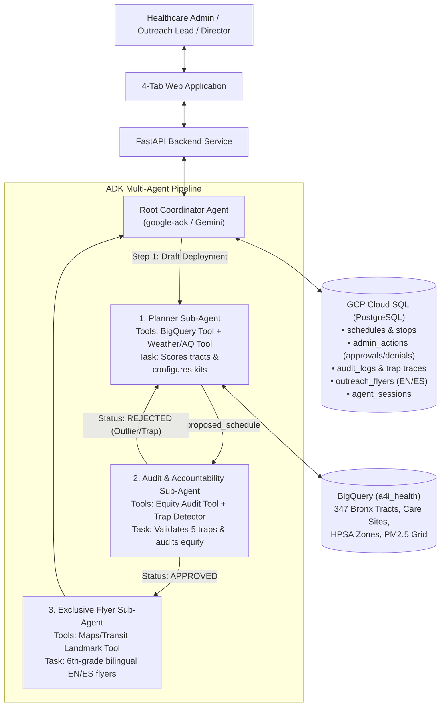

# Dynamic Public Health Equity & Preventative Mobile Care Broker
## End-to-End UX, Multi-Agent Architecture, Cloud SQL Database & Implementation Plan — Bronx County, NY (`FIPS 36005`)

> **Challenge 5 — Google Agents for Impact 2026**: *"One County, One Van, Four Saturdays, and a Reason You Can Say Out Loud."*
> - **Target County**: **Bronx County, New York (`FIPS 36005`)** — 347 populated census tracts (`1,472,508` residents), 252 existing care sites, 7 Medicaid Exception (`ME`) HPSA zones.
> - **GCP Analytics Dataset**: `qwiklabs-gcp-03-c81d344a3430.a4i_health` (verified BigQuery public health tables).
> - **GCP Operational Database**: **Google Cloud SQL (PostgreSQL)** for relational persistence of schedules, admin approval/denial logs, auditor self-correction traces, and bilingual flyers (avoiding Firestore 1MB limits).

---

## 1. Multi-Agent Orchestration & Root Agent Hierarchy

Our architecture implements genuine multi-agent orchestration via the **Google Agent Development Kit (`google-adk`)**. The system is coordinated by a **Root Coordinator Agent** that delegates specialized work across three dedicated sub-agents and persists operational state into **Cloud SQL**.



### 1.1 The Root Agent (`RootCoordinatorAgent`)
- **Role**: Top-level supervisor and state manager.
- **Responsibilities**:
  1. Manages the lifecycle of planning runs, user prompts, and human-in-the-loop review.
  2. Orchestrates sub-agents sequentially: executes `PlannerSubAgent` $\rightarrow$ passes state to `AuditAccountabilitySubAgent` $\rightarrow$ if approved, passes state to `ExclusiveFlyerSubAgent`.
  3. Manages autonomous self-correction loops: if the Auditor rejects a stop, feeds the rejection violations back to the Planner (capped at `max_iterations = 3`).
  4. Manages Human-in-the-Loop Re-Planning: when a Healthcare Admin clicks **Deny Stop with Reason** in the UI, receives the constraint, updates exclusion lists, and invokes the Planner-Auditor pipeline for that stop.
  5. Commits and reads state to/from **GCP Cloud SQL (PostgreSQL)**.

---

### 1.2 The Three Specialized Sub-Agents

#### 1. Planner Sub-Agent (`PlannerSubAgent`)
- **Role**: Siting strategist & clinical resource planner.
- **Bound Tools**:
  - `score_bronx_tracts` (queries BigQuery `burden_tracts`, `shortage_areas`, `tract_access`, `care_sites`).
  - `get_saturday_weather_and_air_quality` (queries Saturday weather forecast + AQI alerts).
- **Core Constraints**:
  - **Strict Race-Blindness**: Strictly banned from reading or weighting race/ethnicity columns (`pct_hispanic`, `pct_black`, etc.) during tract scoring (CDC SVI Theme 3 compliance).
  - **Urban Distance Trap Guardrail**: Distance to clinic is weighted at 0% in the dense Bronx (`0.39 km` median); ranks instead on HPSA shortage scores (`16–19`), clinic operating-hour bottlenecks (`TOT_OPER_HR_PER_WEEK`), uninsured rate, and chronic burden.
- **Output**: Writes `proposed_schedule` to shared state with tract IDs, disease metrics, clinical kit loadouts, and weather postures.

#### 2. Audit & Accountability Sub-Agent (`AuditAccountabilitySubAgent`)
- **Role**: Dedicated trap watchdog and demographic equity auditor.
- **Context Isolation**: Operates with an isolated system prompt (`include_contents="none"`), ensuring it independently critiques the Planner's proposal rather than defending it.
- **Bound Tools**:
  - `run_posthoc_equity_audit` (isolated post-hoc query of `burden_tracts` demographic data).
- **Checks Enforced (The 5 Traps)**:
  1. **Institutional Outlier Check**: Automatically detects and rejects locked facilities (e.g., Rikers Island Jail Complex `36005000100`, Bronx Psychiatric Center `36005028400`, or dorms where `pct_group_quarters > 25%` or `total_pop < 500`).
  2. **HPSA Diversity Check**: Prevents clustering all 4 Saturdays in one corner of the borough; enforces stops across distinct Bronx ME HPSA zones.
  3. **Multi-Scale Environmental Check**: Verifies that annual `mean_pm` (12 km satellite grid) was not falsely cited as neighborhood-level variation.
  4. **NSSP Surveillance Blind Spot Check**: Verifies the plan accounts for 100% missing ED data in `disease_weekly` by provisioning point-of-care rapid respiratory testing.
  5. **Post-Hoc Demographic Equity Verification**: Verifies that the race-blind plan delivers proportional coverage to historically underserved Black and Hispanic populations compared to the Bronx County baseline (`69.8%` Hispanic, `24.1%` Black = `93.9%` combined vs `84.8%` county baseline).
- **Output**: Returns `audit_status: APPROVED` or `REJECTED` with structured violation items.

#### 3. Exclusive Flyer Sub-Agent (`ExclusiveFlyerSubAgent`)
- **Role**: Dedicated community outreach author.
- **Persona Contradiction**: System prompt directly contradicts the Auditor/Planner:
  - **Zero Technical/Policy Jargon**: Forbidden from mentioning "FIPS", "HPSA", "SVI", "GEOID", or "FQHC".
  - **6th-Grade Reading Level**: Simple, encouraging, trust-building tone.
  - **Strictly Bilingual (English + Spanish)**: Side-by-side versions for all assets.
  - **Core Trust Anchors**: Emphasizes *"Free care. No health insurance needed. No ID required to be seen. Walk-ins welcome."*
- **Bound Tools**:
  - `resolve_stop_landmark_and_map_context` (anchors stops to real parks, plazas, and MTA subway/bus stops from Google Maps).
- **Output**: Full flyer text, 160-character WhatsApp/SMS alerts, and 30-second Community Health Worker (CHW) door-knocking talking points.

---

## 2. GCP Database Architecture: Cloud SQL (PostgreSQL)

To avoid Firestore's 1 MB document limit and provide full relational integrity for schedules, rejections, audit traces, and flyers, we provision a **Google Cloud SQL (PostgreSQL 16)** instance.

### 2.1 GCP Cloud SQL Provisioning Spec
- **Instance ID**: `public-health-db`
- **Database Name**: `public_health_broker`
- **Region**: Matching GCP project region (e.g. `us-central1` or `us-east4`)
- **Tier**: `db-f1-micro` or `db-custom-2-7680` (efficient, scalable)
- **Connectivity**: Cloud SQL Python Connector / asyncpg connection pool

### 2.2 Relational Database Schema

```sql
-- 1. Schedules Table (Master monthly plans)
CREATE TABLE schedules (
    id UUID PRIMARY KEY DEFAULT gen_random_uuid(),
    county_fips VARCHAR(5) NOT NULL DEFAULT '36005',
    county_name VARCHAR(100) NOT NULL DEFAULT 'Bronx County, NY',
    target_month VARCHAR(20) NOT NULL,
    status VARCHAR(30) NOT NULL DEFAULT 'DRAFT', -- DRAFT, AUDITED, APPROVED, REJECTED
    created_at TIMESTAMP WITH TIME ZONE DEFAULT CURRENT_TIMESTAMP,
    updated_at TIMESTAMP WITH TIME ZONE DEFAULT CURRENT_TIMESTAMP
);

-- 2. Schedule Stops Table (Individual Saturday van deployments)
CREATE TABLE schedule_stops (
    id UUID PRIMARY KEY DEFAULT gen_random_uuid(),
    schedule_id UUID REFERENCES schedules(id) ON DELETE CASCADE,
    saturday_index INT NOT NULL CHECK (saturday_index BETWEEN 1 AND 4),
    saturday_date DATE NOT NULL,
    geo_id VARCHAR(11) NOT NULL,
    neighborhood VARCHAR(100) NOT NULL,
    hpsa_name VARCHAR(100) NOT NULL,
    hpsa_score INT NOT NULL,
    landmark_name VARCHAR(255) NOT NULL,
    street_intersection VARCHAR(255) NOT NULL,
    subway_lines TEXT[] NOT NULL,
    bus_lines TEXT[] NOT NULL,
    lat NUMERIC(9, 6) NOT NULL,
    lon NUMERIC(9, 6) NOT NULL,
    total_pop INT NOT NULL,
    pct_uninsured NUMERIC(5, 2) NOT NULL,
    pct_asthma NUMERIC(5, 2) NOT NULL,
    pct_diabetes NUMERIC(5, 2) NOT NULL,
    van_setup_mode VARCHAR(150) NOT NULL,
    clinical_kits JSONB NOT NULL,
    weather_forecast JSONB NOT NULL,
    siting_rationale TEXT NOT NULL,
    is_active BOOLEAN DEFAULT TRUE,
    created_at TIMESTAMP WITH TIME ZONE DEFAULT CURRENT_TIMESTAMP
);

-- 3. Admin Actions Table (Human-in-the-Loop audit trail)
CREATE TABLE admin_actions (
    id UUID PRIMARY KEY DEFAULT gen_random_uuid(),
    schedule_id UUID REFERENCES schedules(id) ON DELETE CASCADE,
    stop_id UUID REFERENCES schedule_stops(id),
    action_type VARCHAR(20) NOT NULL, -- APPROVE, DENY, REPLAN
    rejection_category VARCHAR(50),  -- ROAD_CONSTRUCTION, COMMUNITY_EVENT, CLEARANCE, CAPACITY
    rejection_reason TEXT,           -- Admin's verbatim explanation
    admin_user VARCHAR(100) DEFAULT 'admin@bronxhealth.org',
    timestamp TIMESTAMP WITH TIME ZONE DEFAULT CURRENT_TIMESTAMP
);

-- 4. Audit Logs Table (Trap detection & self-correction trace for judges)
CREATE TABLE audit_logs (
    id UUID PRIMARY KEY DEFAULT gen_random_uuid(),
    schedule_id UUID REFERENCES schedules(id) ON DELETE CASCADE,
    iteration_number INT NOT NULL,
    audit_status VARCHAR(20) NOT NULL, -- APPROVED, REJECTED
    institutional_outliers_detected JSONB,
    hpsa_diversity_status VARCHAR(50),
    demographic_coverage_ratios JSONB NOT NULL,
    violations JSONB,
    auditor_comments TEXT NOT NULL,
    created_at TIMESTAMP WITH TIME ZONE DEFAULT CURRENT_TIMESTAMP
);

-- 5. Outreach Flyers Table (Exclusive Flyer Agent outputs)
CREATE TABLE outreach_flyers (
    id UUID PRIMARY KEY DEFAULT gen_random_uuid(),
    schedule_id UUID REFERENCES schedules(id) ON DELETE CASCADE,
    stop_id UUID REFERENCES schedule_stops(id) ON DELETE CASCADE,
    saturday_index INT NOT NULL,
    flyer_headline_en VARCHAR(255) NOT NULL,
    flyer_body_en TEXT NOT NULL,
    flyer_headline_es VARCHAR(255) NOT NULL,
    flyer_body_es TEXT NOT NULL,
    sms_broadcast_en VARCHAR(200) NOT NULL,
    sms_broadcast_es VARCHAR(200) NOT NULL,
    chw_script_en TEXT NOT NULL,
    chw_script_es TEXT NOT NULL,
    created_at TIMESTAMP WITH TIME ZONE DEFAULT CURRENT_TIMESTAMP
);

-- 6. Agent Sessions Table (ADK state & chat history)
CREATE TABLE agent_sessions (
    session_id VARCHAR(100) PRIMARY KEY,
    user_id VARCHAR(100) NOT NULL,
    session_state JSONB NOT NULL,
    chat_history JSONB NOT NULL,
    updated_at TIMESTAMP WITH TIME ZONE DEFAULT CURRENT_TIMESTAMP
);
```

---

## 3. End-to-End User Experience (UX) — 4-Tab Web Application

| UI Tab | Primary User Persona | Core Capabilities & Interactions | Cloud SQL & Multi-Agent Flow |
| :--- | :--- | :--- | :--- |
| **Tab 1: Monthly Scheduler & HITL Re-Planner** | Healthcare Admin / Outreach Lead | • Displays 4-Saturday deployment cards.<br>• Shows weather posture, AQI alert, and clinical kit configurations.<br>• **Approve Button**: Persists approval to `admin_actions`.<br>• **Deny with Reason Button**: Modal captures reason (e.g. *"ConEd road work"*), invokes `RootCoordinatorAgent.replan_rejected_saturday()`, updates `schedule_stops`, and logs action. | Reads/Writes `schedules`, `schedule_stops`, `admin_actions`. Invokes `PlannerSubAgent` $\rightarrow$ `AuditAccountabilitySubAgent`. |
| **Tab 2: Interactive Bronx Map & Earth View** | Outreach Lead & Community Workers | • Interactive choropleth of all 347 populated Bronx tracts.<br>• 252 existing care sites color-coded by operating hours (`TOT_OPER_HR_PER_WEEK`).<br>• **Red Warning Pins** on institutional outlier tracts automatically rejected by the Auditor (Rikers Island, Psych Center).<br>• Google Street View & 3D Earth panel for the 4 active stops. | Reads `schedule_stops`, joins BigQuery geometries and clinic locations. |
| **Tab 3: Public Notice & Bilingual Flyer Studio** | Community Health Worker (CHW) & Residents | • Side-by-side **English and Spanish** print-ready flyers.<br>• 6th-grade reading level, zero database acronyms.<br>• WhatsApp / SMS broadcast copy.<br>• 30-second CHW door-to-door talking points anchored to local landmarks. | Reads `outreach_flyers`. Generated by `ExclusiveFlyerSubAgent`. |
| **Tab 4: Director Chat & Equity/Audit Inspector** | Health Department Director & Judges | • Interactive executive Q&A chat with evidence citations.<br>• Post-hoc demographic equity scorecard (Black & Hispanic coverage vs baseline).<br>• Live inspection of `audit_logs` showing the autonomous **Planner $\leftrightarrow$ Auditor rejection and self-correction trace**. | Reads `audit_logs`, `agent_sessions`. Invokes Director briefing agent. |

---

## 4. The 5 Bronx Data Traps & Guardrails Handled

1. **Trap 1: The Urban Distance Illusion (`tract_access`)**:
   - In the Bronx, median distance to care is only `0.39 km` (`390 meters`), and `extra_km_if_uninsured` is `0 km` for 94% of tracts.
   - **Guardrail**: Distance penalty is weighted at 0%; ranking is driven by HPSA shortage severity, clinic weekend/evening hour shortages, uninsured rates, and transit/language barriers.
2. **Trap 2: The Institutional / Group Quarters Outlier Trap (`pct_group_quarters`)**:
   - Rikers Island (`36005000100`, pop 3,772) and Bronx Psychiatric Center (`36005028400`, pop 297) have 100% group quarters and SVI `-999` sentinels (`pct_no_vehicle IS NULL`). Naive queries site vans at correctional or psychiatric facilities.
   - **Guardrail**: Both the scoring engine and `AuditAccountabilitySubAgent` strictly reject tracts where `pct_group_quarters > 25%` or `total_pop < 500`, logging rejections in `audit_logs`.
3. **Trap 3: Coarse 12 km $\text{PM}_{2.5}$ Grid Trap (`exposure_tracts`)**:
   - Annual `mean_pm` is nearly flat across the borough (`8.08–8.37 µg/m³`).
   - **Guardrail**: Blocked from tract ranking. Peak `max_pm` (`57.0 µg/m³`) + Saturday weather forecasts configure respiratory kits (nebulizers, pediatric spacers).
4. **Trap 4: NSSP ED Data Blind Spot (`disease_weekly`)**:
   - Bronx ED respiratory visits are 100% NULL across all 212 weeks.
   - **Guardrail**: Acknowledged as a surveillance blind spot; mobile van is equipped with point-of-care rapid Flu/COVID/RSV testing.
5. **Trap 5: Race/Ethnicity Input-vs-Audit Separation**:
   - Race is banned from model inputs (SVI Theme 3).
   - **Guardrail**: `PlannerSubAgent` is race-blind. Only `AuditAccountabilitySubAgent` conducts post-hoc audits in an isolated step, verifying `69.8%` Hispanic and `24.1%` Black coverage (`93.9%` combined vs `84.8%` county baseline).

---

## 5. Implementation Roadmap

1. **GCP Cloud SQL Setup**:
   - Create Cloud SQL (PostgreSQL) instance or provision database schemas using SQLAlchemy / asyncpg.
2. **ADK Agent Implementation**:
   - Build `RootCoordinatorAgent`, `PlannerSubAgent`, `AuditAccountabilitySubAgent`, and `ExclusiveFlyerSubAgent`.
3. **FastAPI Backend & UI**:
   - Implement REST endpoints for schedule retrieval, approval/denial re-planning, and flyer generation.
   - Connect the 4-tab web interface with live maps, flyer studio, and audit logs.
4. **Verification & Testing**:
   - Verify Planner-Auditor self-correction loop and persist all traces in Cloud SQL.
