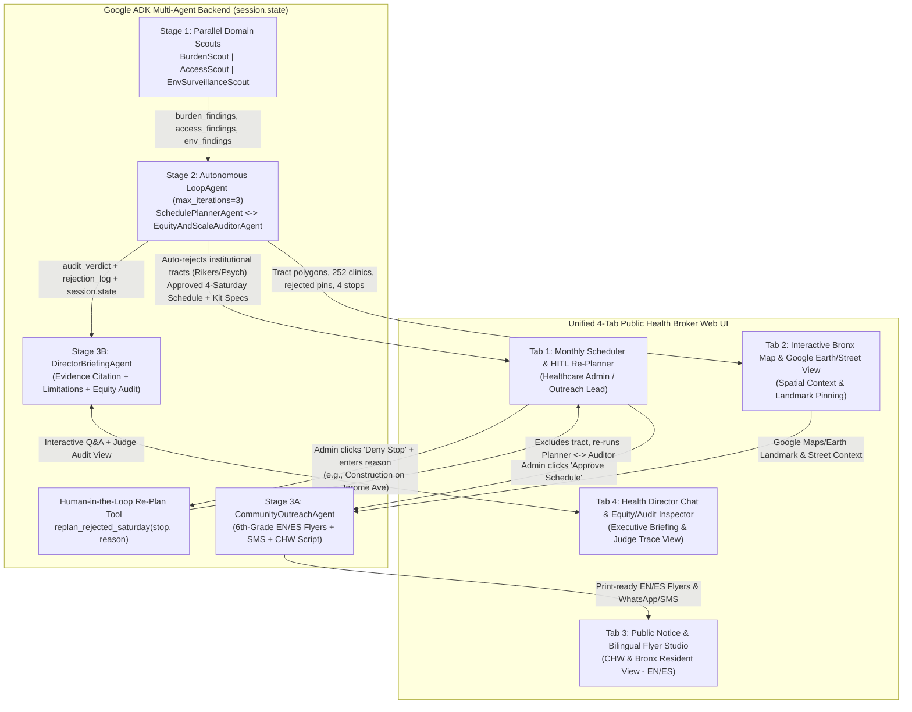

# Dynamic Public Health Equity & Preventative Mobile Care Broker
## End-to-End UX, Multi-Agent Architecture & Implementation Plan — Bronx County, NY (`FIPS 36005`)

> **Challenge 5 — Google Agents for Impact 2026**: *"One County, One Van, Four Saturdays, and a Reason You Can Say Out Loud."*
> - **Target County**: **Bronx County, New York (`FIPS 36005`)** — 347 populated census tracts (`1,472,508` residents), 252 existing care sites, 7 Medicaid Exception (`ME`) HPSA zones.
> - **GCP Project & Dataset**: `qwiklabs-gcp-03-c81d344a3430.a4i_health` (loaded and verified in BigQuery).

---

## 1. End-to-End User Experience (UX) & Persona Journeys

Our application serves **three distinct real-world public health personas** plus **hackathon judges** through a unified 4-tab web workspace backed by our Google ADK Multi-Agent System and FastAPI backend.

### 1.1 Personas & Core Workflows

| Persona | Primary Goal | Primary UI Tab(s) | Key Agent & Tool Touchpoints |
| :--- | :--- | :--- | :--- |
| **1. Healthcare Admin / Mobile Outreach Lead** | Plan the 4-Saturday mobile clinic schedule, verify weather/street feasibility, and **Approve** or **Deny with a Reason** (triggering live re-planning). | **Tab 1: Monthly Scheduler & Re-Planner**<br>**Tab 2: Interactive Bronx Map & Earth View** | `SchedulePlannerAgent` $\leftrightarrow$ `EquityAndScaleAuditorAgent`, `score_bronx_tracts`, `get_saturday_weather_and_air_quality`, `replan_rejected_saturday`, `resolve_stop_landmark_and_map_context` |
| **2. Community Health Worker (CHW) / Public Resident** | Generate and distribute zero-jargon, 6th-grade reading level **English + Spanish** flyers, SMS/WhatsApp alerts, and door-knocking scripts anchored to real local landmarks. | **Tab 3: Public Notice & Bilingual Flyer Studio**<br>**Tab 2: Interactive Bronx Map & Earth View** | `CommunityOutreachAgent`, Google Maps Places/Geocoding & Street/Satellite View context |
| **3. Health Department Director (Executive & Judge)** | Interrogate *why* specific tracts were chosen over others, inspect data limitations & multi-scale guardrails, verify the post-hoc demographic equity audit, and inspect live agent self-correction traces. | **Tab 4: Director Chat & Equity/Audit Inspector** | `DirectorBriefingAgent`, `run_posthoc_equity_audit`, ADK `session.state` & Rejection Trace Inspector |

### 1.2 End-to-End UX Flow Diagram



---

## 2. Detailed UX Specifications by Tab

### Tab 1: Healthcare Admin Monthly Scheduler & Human-in-the-Loop Re-Planner
1. **4-Saturday Deployment Cards (Weeks 1–4)**:
   - Each Saturday card displays:
     - **Target Neighborhood & Tract**: e.g., *Saturday 1 — High Bridge (`36005006700`)*, *Saturday 2 — Pelham (`36005008600`)*, *Saturday 3 — Fordham (`36005040302`)*, *Saturday 4 — Hunts Point (`36005002300`)*.
     - **Plain-Language Siting Reason**: Explains in one clear sentence why the van is parked here (citing HPSA score, uninsured rate, asthma/diabetes burden, and nearby clinic weekend/evening operating-hour bottleneck—never false distance claims).
     - **Live Weather & Air Quality Integration (`get_saturday_weather_and_air_quality`)**: Displays forecasted Saturday temperature, precipitation probability, AQI / $\text{PM}_{2.5}$ alert level, and automatic operational posture (*Open-Air Canopy Setup* vs. *Indoor/Awning Rain Protocol* vs. *High-PM2.5 Nebulizer Surge Kit*).
     - **Tailored Clinical Kit Loadout**: Dynamically configured based on tract disease profile (e.g., *Pediatric & Adult Asthma Spacer/Inhaler Kit*, *A1C & Blood Pressure Cardiometabolic Kit*, *Spanish Medical Interpreter + Medicaid Enrollment Desk*, *Point-of-Care Rapid Flu/COVID/RSV Swab Kit* to cover the `disease_weekly` blind spot).
2. **Interactive Admin Actions (`Approve` / `Deny with Reason`)**:
   - **Approve Button**: Locks the stop and triggers `CommunityOutreachAgent` to finalize bilingual notices.
   - **Deny with Reason Modal**: Admin selects a category (*Road Construction / Street Closure*, *Competing Community Event*, *Parking / Van Clearance Issue*, *Staffing / Kit Constraint*) and enters free text (e.g., *"ConEd utility work blocking Grand Concourse curb lane on Saturday 2"*).
   - **Live Agent Re-Plan**: The backend invokes `replan_rejected_saturday`, appends the constraint to `session.state["admin_excluded_tracts"]`, selects the next-highest valid residential tract (either within the same HPSA zone to preserve geographic equity or the #5 zone **ME - Crotona `36005020501`**), re-runs the `EquityAndScaleAuditorAgent`, and updates the UI with a visual diff showing *Previous Stop $\rightarrow$ Replacement Stop*.

### Tab 2: Interactive Bronx Map & Google Maps / Earth View
1. **Multi-Layer Choropleth & Pin Map (347 Populated Tracts)**:
   - Toggleable layers for **Composite Preventative Need Score**, **HPSA Designation Zones (7 `ME` zones)**, **Asthma / Cardiometabolic Burden**, **Uninsured Rate (`18–64`)**, and **252 Existing Care Sites** (color-coded by `TOT_OPER_HR_PER_WEEK` so users see where 8–20 hr/wk part-time clinics create evening/weekend deserts).
2. **Visualizing the Autonomous Guardrails (Red "Rejected Outlier" Pins)**:
   - Displays red warning markers on institutional outlier tracts automatically caught and rejected by the `EquityAndScaleAuditorAgent` (e.g., `36005000100` Rikers Island Jail Complex, `36005028400` Bronx Psychiatric Center, `36005031900` Maritime College Dorms) with tooltips showing `pct_group_quarters = 100%`.
3. **Google Maps / Earth Street & Landmark Inspector**:
   - Clicking any of the 4 Saturday stops opens a split **Google Street View / 3D Earth & Landmark Panel** showing the exact community anchor (e.g., *Mullaly Park / 165th St Plaza in High Bridge*, *White Plains Rd & Pelham Pkwy Transit Hub*, *Fordham Plaza*, *Hunts Point Julio Carballo Fields*), closest subway/bus lines (`4/B/D`, `2/5`, `6`), and van parking feasibility.

### Tab 3: Public Notice & Bilingual Flyer Studio (CHW & Resident View)
1. **Zero-Jargon Community Flyer Generator (`CommunityOutreachAgent`)**:
   - Generates side-by-side **English and Spanish** public notices written strictly at a **6th-grade reading level**:
     - Zero acronyms or database jargon (never says *"FIPS 36005006700"*, *"HPSA Score 18"*, *"SVI Theme 1"*, or *"FQHC"*).
     - Anchors location to familiar neighborhood landmarks and subway/bus stops from the Google Maps tool.
     - Explicitly states: **"Free care. No health insurance needed. No ID required to be seen. Walk-ins welcome every Saturday 9 AM – 4 PM. Hablamos Español."**
2. **Multi-Channel Outreach Pack**:
   - **Print-Ready Flyer Preview (PDF/Print view)** for bodegas, churches, barbershops, and elementary schools.
   - **160-Character SMS / WhatsApp Broadcast Copy** (English & Spanish) for local tenant associations.
   - **CHW Door-Knocking & Tabling Script**: 30-second trust-building talking points tailored to that neighborhood's specific health concerns (e.g., childhood asthma triggers in Hunts Point / High Bridge, blood pressure and diabetes checks in Pelham, Spanish-first enrollment in Fordham).

### Tab 4: Health Director Chat & Equity/Audit Inspector (Executive & Judge View)
1. **Interactive Health Director Q&A Chat (`DirectorBriefingAgent`)**:
   - Pre-loaded quick-prompt chips for judges and executives, plus free-form chat:
     - *"Why did we pick these 4 tracts over the other 343 tracts in the Bronx?"*
     - *"Why didn't we park the van based on distance to the nearest clinic?"*
     - *"Why was tract 36005028400 or Rikers Island (36005000100) rejected despite having the highest raw asthma/diabetes rates?"*
     - *"What data is missing or at the wrong spatial/temporal scale, and how did the system guard against it?"*
     - *"Did our race-blind ranking produce an equitable outcome across Bronx racial and ethnic groups?"*
2. **Post-Hoc Demographic Equity Audit Scorecard**:
   - Displays the isolated audit comparing the **4 Selected Residential Tracts (`19,977` residents)** vs. **Bronx County Baseline (`1,472,508` residents)** across `pct_hispanic`, `pct_black`, `pct_asian`, `pct_white`, and `pct_poverty`.
3. **Live Agent Execution & Self-Correction Trace (`session.state` Inspector)**:
   - Shows the step-by-step autonomous loop: **Planner Draft 1 (or Outlier Test)** $\rightarrow$ **Auditor Rejection Verdict** $\rightarrow$ **Planner Self-Correction** $\rightarrow$ **Human Admin Rejection (if triggered)** $\rightarrow$ **Final Approved State**.

---

## 3. Live BigQuery Data Inventory & The 5 Bronx Data Traps

All 7 tables in `qwiklabs-gcp-03-c81d344a3430.a4i_health` have been verified against live Bronx County (`36005`) records:

### 3.1 BigQuery Table Inventory (`qwiklabs-gcp-03-c81d344a3430.a4i_health`)

| Table | Bronx Rows | Spatial Grain & Join Key | Live Bronx Findings & Role in Architecture |
| :--- | :---: | :--- | :--- |
| `burden_tracts` | **347** | Census Tract (`geo_id`, 11-char string `36005...`) | `1,472,508` total pop. High chronic burden: avg asthma `11.94%` (max `15.7%`), avg uninsured (18–64) `15.69%` (max `33.4%`), `pct_lack_transport` populated (`13.84%` avg). Contains `pct_race_*` columns that **must be excluded from siting ranking** and reserved exclusively for the post-hoc Equity Auditor. |
| `shortage_areas` | **338** | Tract-level HPSA (`GEO_ID`, `geo_id_len = 11`) | **7 Medicaid Exception (`ME`) HPSA zones** covering 338 of 347 tracts: **ME - Pelham** (`HPSA_SCORE = 19`, 83 tracts), **ME - High Bridge** (`18`, 39 tracts), **ME - Northeast Bronx** (`18`, 54 tracts), **ME - Fordham** (`17`, 39 tracts), **ME - Crotona** (`17`, 66 tracts), **ME - Hunts Point** (`16`, 35 tracts), **ME - Riverdale** (`16`, 22 tracts). |
| `care_sites` | **252** | Point Lat/Lon (`lat`, `lon`, `COUNTY_CLEAN`) | `151` Health Center sites (`TOT_OPER_HR_PER_WEEK` from `8` to `112` hrs/wk, avg `43.8`), `92` FQHCs, `9` Hospitals. Crucial for identifying **operating-hour bottlenecks** (clinics open only 8–20 hrs/wk on weekdays). |
| `tract_access` | **347** | Census Tract (`geo_id`, 11-char string) | Pre-joined tract centroids (`lat`, `lon`) + distance to care. **Bronx median distance to any clinic is `0.39 km` (`390 meters`), median distance to safety-net is `0.50 km`, max `extra_km_if_uninsured` is `0.65 km`** (only 20 of 347 tracts have `extra_km_if_uninsured > 0`). |
| `shortage_facilities` | **8** | Point Facility (`lat`, `lon`, `HPSA_ID`) | 8 major FQHC networks (Montefiore, Urban Health Plan, BronxCare, La Casa de Salud, Union Community Health Center, VIP Community Services, Morris Heights, Bronx Community Health Network). Marks where care *already exists*—**never `UNION` with `shortage_areas`**. |
| `exposure_tracts` | **361** | Census Tract (`geo_id`, interpolated from 12 km grid) | 347 populated + 14 unpopulated park/water tracts. Annual `mean_pm` is virtually flat across the entire Bronx (`8.08–8.37 µg/m³`, only `1.33%` CV), whereas daily peak `max_pm` reached **`57.0 µg/m³`** (`16–17` `days_over_20`, `1` `days_over_35`). |
| `disease_weekly` | **212** | County-Week (`fips = 36005` INT64) | **100% NULL (`Data Unavailable`) across all 212 weeks (`2022–2026`)** for COVID-19, Influenza, and RSV (`ed_pct_*` is null in every row). |

---

### 3.2 The 5 Critical Bronx Data Traps & How Our System Solves Them

| Trap | What Happens to a Naive Agent | Our Architectural Guardrail |
| :--- | :--- | :--- |
| **Trap 1: The Bronx Urban Distance Trap (`tract_access`)** | Ranks tracts by `km_to_safety_net` or `extra_km_if_uninsured`. Because the Bronx is dense (`0.39 km` median distance, `0.65 km` max uninsured distance penalty), a distance-based ranking picks low-need outer peripheral tracts near parks/waterways and fails the challenge rubric. | **Capacity & Barrier Dominance**: Our `score_bronx_tracts` tool weights `extra_km_if_uninsured` at `0%` in urban counties where `max(extra_km_if_uninsured) < 1.0 km`. Instead, it ranks on **HPSA Shortage Score (`HPSA_SCORE`)**, **local clinic operating-hour bottlenecks (`TOT_OPER_HR_PER_WEEK`)**, **uninsured rate (`pct_uninsured`)**, **chronic/respiratory burden (`pct_asthma`, `pct_diabetes`, `pct_high_bp`, inverse `pct_checkup`)**, and **social/mobility barriers (`pct_lack_transport`, `pct_no_vehicle`, `pct_limited_english`, `pct_mobility_difficulty`)**. |
| **Trap 2: The Institutional / Group Quarters Outlier Trap (`pct_group_quarters`)** | Ranks tracts by raw `pct_asthma`, `pct_diabetes`, or `pct_lack_transport` without filtering institutional populations. In live Bronx data, the top raw tracts are **`36005028400`** (pop `297`, `100%` group quarters — Bronx Psychiatric Center), **`36005000100`** (pop `3,772`, `100%` group quarters — **Rikers Island Jail Complex**), **`36005031900`** (pop `454`, `100%` group quarters — SUNY Maritime), and **`36005009302`** (pop `512`, `100%` group quarters). Worse, these tracts have `pct_no_vehicle IS NULL` (from SVI `-999` sentinels). A naive agent dispatches the Saturday community van to Rikers Island! | **Two-Layer Institutional Filter & Autonomous Self-Correction**: Both the `score_bronx_tracts` tool and the independent `EquityAndScaleAuditorAgent` enforce a hard rule: **Reject any tract with `pct_group_quarters > 25%` or `total_pop < 500`**, and handle `NULL` SVI fields via `SAFE_DIVIDE` / median imputation rather than dropping rows or mis-scoring. We explicitly showcase this rejection in the UI and Judge Trace. |
| **Trap 3: The Coarse 12 km $\text{PM}_{2.5}$ Grid Trap (`exposure_tracts`)** | Uses `mean_pm` (`8.08–8.37 µg/m³`) to differentiate neighborhood-level asthma risk between Bronx tracts, claiming one neighborhood has "worse annual PM2.5" than another when the underlying satellite grid is ~12 km (almost the size of the entire borough). | **Scale-Aware Environmental Rule**: `EnvSurveillanceScout` and `EquityAndScaleAuditorAgent` block `mean_pm` from tract-level ranking. Instead, `max_pm` (`57.0 µg/m³`) + `days_over_20` (`17 days`) + our **live Saturday Weather/AQ tool** are combined with tract-level `pct_asthma` (`13.0%–14.8%`) to configure **clinical kit supplies** (nebulizers, pediatric spacers, air-quality action plans). |
| **Trap 4: The `disease_weekly` NSSP Dark-Signal Trap** | Either hallucinates respiratory trends, crashes on `NULL` aggregation, or joins county-level `fips = 36005` (INT64) onto 347 tract rows as if every tract had separate ED data. | **Explicit Blind-Spot Operationalization**: `EnvSurveillanceScout` queries `disease_weekly` with `COUNTIF(ed_pct_covid IS NOT NULL)`, detects `0 / 212` populated weeks (`Data Unavailable`), and flags an **Active Surveillance Blind Spot**. The Planner responds by adding **Point-of-Care Rapid Flu/COVID/RSV Swab Kits** to the mobile van so the van itself serves as a sentinel surveillance node, while `DirectorBriefingAgent` cites this limitation transparently. |
| **Trap 5: Race/Ethnicity Input-vs-Audit Separation (`burden_tracts`)** | Either includes `pct_hispanic` / `pct_black` in the SQL ranking formula (violating the CDC SVI Theme 3 exclusion rule) or ignores race/ethnicity completely (failing the equity verification requirement). | **Architectural Context Isolation**: `BurdenScout` and `SchedulePlannerAgent` never query `pct_race_*` columns. Only the isolated `EquityAndScaleAuditorAgent` (via `run_posthoc_equity_audit`) queries `pct_hispanic`, `pct_black`, `pct_asian`, and `pct_white` *after* the 4 tracts are selected to verify distributional equity against the Bronx County baseline. |

---

## 4. Multi-Agent ADK Architecture & Tooling Stack

We use **Google Agent Development Kit (`google-adk`)** on **Vertex AI (`gemini-2.5-flash` / `gemini-2.5-pro`)** to orchestrate 7 specialized agents across three stages, meeting every requirement of the **10-Point Multi-Agent Bonus**:

### 4.1 Agent Topology & Shared State Contract (`session.state`)

| Stage | Agent Name & Type | Tools | `output_key` in `session.state` | Core Responsibility & Constraints |
| :--- | :--- | :--- | :--- | :--- |
| **Stage 1 (Parallel)** | `BurdenScout` (`LlmAgent` inside `ParallelAgent`) | BigQuery MCP + `score_bronx_tracts` | `burden_findings` | Queries `burden_tracts` for chronic/preventative burden (`pct_asthma`, `pct_diabetes`, `pct_high_bp`, `pct_checkup`, `pct_uninsured`, `pct_lack_transport`, `pct_no_vehicle`, `pct_limited_english`). **Banned from reading `pct_race_*` columns.** Flags institutional tracts (`pct_group_quarters > 25%`). |
| **Stage 1 (Parallel)** | `AccessScout` (`LlmAgent` inside `ParallelAgent`) | BigQuery MCP | `access_findings` | Queries `shortage_areas` (`geo_id_len = 11`), `care_sites` (`TOT_OPER_HR_PER_WEEK`), `tract_access`, and `shortage_facilities`. Proves the Bronx distance trap (`0.39 km` median) and identifies the 7 `ME` HPSA zones and part-time clinic bottlenecks. |
| **Stage 1 (Parallel)** | `EnvSurveillanceScout` (`LlmAgent` inside `ParallelAgent`) | BigQuery MCP + `get_saturday_weather_and_air_quality` | `env_findings` | Queries `exposure_tracts` (`max_pm = 57.0 µg/m³`, `mean_pm` 12 km grid note) and `disease_weekly` (`0/212` populated weeks), plus Saturday weather/AQI forecast. |
| **Stage 2 (Iterative Loop)** | `SchedulePlannerAgent` (`LlmAgent` inside `LoopAgent`) | `score_bronx_tracts`, `get_saturday_weather_and_air_quality`, `resolve_stop_landmark_and_map_context`, `replan_rejected_saturday` | `proposed_schedule` | Synthesizes `burden_findings`, `access_findings`, and `env_findings` into a 4-Saturday schedule across distinct HPSA zones with tailored clinical kits, weather posture, and Google Maps landmarks. Reads `audit_verdict` and `admin_excluded_tracts` to self-correct when a stop is rejected. |
| **Stage 2 (Iterative Loop)** | `EquityAndScaleAuditorAgent` (`LlmAgent` inside `LoopAgent`, **Isolated Context**) | `run_posthoc_equity_audit`, `exit_loop` | `audit_verdict` | **Independent Reviewer (`include_contents="none"`)**: Inspects only `proposed_schedule` from `session.state`. Rejects the plan if: (1) any tract has `pct_group_quarters > 25%` or `total_pop < 500`, (2) all 4 Saturdays cluster in the same HPSA zone, (3) `mean_pm` or `extra_km_if_uninsured` is cited as a primary Bronx differentiator, or (4) post-hoc racial/ethnic equity audit fails (`<80%` of county baseline for underserved groups). Calls `exit_loop` only when all checks pass. |
| **Stage 3A (Persona 1)** | `DirectorBriefingAgent` (`LlmAgent`) | BigQuery MCP (read-only verification) | `director_briefing` | **Health Department Director Persona**: Rigorous, data-citing, transparent about multi-scale caveats (`12 km` $\text{PM}_{2.5}$ grid, `disease_weekly` nulls, institutional rejections) and post-hoc demographic equity results. Powers Tab 4 Director Chat. |
| **Stage 3B (Persona 2)** | `CommunityOutreachAgent` (`LlmAgent`) | `resolve_stop_landmark_and_map_context` | `community_notices` | **Community Resident / CHW Persona**: Contradictory instructions to `DirectorBriefingAgent`—strictly **6th-grade reading level**, **zero database/policy jargon**, **bilingual English + Spanish**, anchored to real street landmarks and transit lines, emphasizing free care with no insurance or ID barrier. Powers Tab 3 Flyer Studio. |

---

### 4.2 Custom Tools & External Integrations

1. **Google-Managed BigQuery MCP / ADK BigQuery Toolset**:
   - Connects directly to `qwiklabs-gcp-03-c81d344a3430.a4i_health` for schema discovery and ad-hoc SQL verification in the Director Chat.
2. **`score_bronx_tracts(exclude_geo_ids: list[str], enforce_hpsa_diversity: bool, demo_include_outliers: bool)`**:
   - Computes the **Bronx Preventative & Access-Barrier Composite Score (`0–100`)** across all 347 populated tracts using min-max percentile normalization within `36005`:
     $$\text{CompositeNeedScore} = 0.25 \cdot \text{HPSA\_Norm} + 0.25 \cdot \text{Uninsured\_Access\_Norm} + 0.30 \cdot \text{Chronic\_Preventative\_Norm} + 0.20 \cdot \text{Mobility\_Language\_SVI\_Norm}$$
     where:
     - $\text{HPSA\_Norm} = \text{norm}(\text{HPSA\_SCORE}) \text{ (scores 16–19 across the 7 ME zones)}$
     - $\text{Uninsured\_Access\_Norm} = 0.55 \cdot \text{norm}(\text{pct\_uninsured}) + 0.30 \cdot \text{norm}(100 - \text{pct\_checkup}) + 0.15 \cdot \text{norm}(\text{clinic\_hours\_gap})$
     - $\text{Chronic\_Preventative\_Norm} = 0.40 \cdot \text{norm}(\text{pct\_asthma}) + 0.35 \cdot \text{norm}(\text{pct\_diabetes}) + 0.25 \cdot \text{norm}(\text{pct\_high\_bp})$
     - $\text{Mobility\_Language\_SVI\_Norm} = 0.35 \cdot \text{norm}(\text{pct\_lack\_transport}) + 0.25 \cdot \text{norm}(\text{pct\_no\_vehicle}) + 0.20 \cdot \text{norm}(\text{pct\_limited\_english}) + 0.20 \cdot \text{norm}(\text{svi\_t1})$
   - Note: `demo_include_outliers=True` can be toggled in the Judge Inspector to watch the Planner propose `36005028400` (Psychiatric Center) / `36005000100` (Rikers Island) on Iteration 1 and watch `EquityAndScaleAuditorAgent` autonomously reject and self-correct on Iteration 2!
3. **`get_saturday_weather_and_air_quality(lat: float, lon: float, saturday_date: str)`**:
   - Queries **Open-Meteo / Google Weather & Air Quality API** (with deterministic fallback for offline/sandbox stability) for the 4 upcoming Saturdays at the exact tract centroid (`lat`, `lon`).
   - Returns temperature, rain probability, wind speed, forecasted AQI / $\text{PM}_{2.5}$, historical peak `max_pm` (`57.0 µg/m³`), and recommended **Van Setup Mode** (*Standard Curbside Canopy*, *High-Heat Hydration + Shaded Intake*, *Rain/Wind Covered Plaza Protocol*, or *Elevated AQI Nebulizer & Mask Distribution*).
4. **`resolve_stop_landmark_and_map_context(geo_id: str, lat: float, lon: float)`**:
   - Enriches each census tract centroid with **Google Maps / Places / Street View / Earth metadata**: exact street intersection, recognizable neighborhood anchor (park, plaza, library, transit hub), nearest MTA Subway & Bx Bus routes, nearby existing `care_sites` within `0.5 km` (including their `TOT_OPER_HR_PER_WEEK` operating hours), and Google Maps/Earth embed URLs.
5. **`run_posthoc_equity_audit(selected_geo_ids: list[str])`**:
   - Queries `pct_hispanic`, `pct_black`, `pct_asian`, `pct_white`, `pct_poverty`, and `total_pop` for the 4 selected tracts vs. all 347 Bronx tracts. Computes population-weighted coverage ratios and returns a structured `PASS` / `REJECT` verdict.
6. **`replan_rejected_saturday(saturday_index: int, rejected_geo_id: str, rejection_reason: str, prefer_same_hpsa: bool)`**:
   - Powers the **Healthcare Admin Deny-with-Reason UX**. Logs the admin's operational constraint (`rejection_reason`), adds `rejected_geo_id` to `admin_excluded_tracts`, selects the optimal replacement tract, re-runs the post-hoc equity audit, and regenerates the bilingual flyer and director briefing.

---

### 4.3 Verified 4-Saturday Baseline Schedule & Backup Re-Plan Candidates (Live Bronx Data)

| Saturday | HPSA Zone (`HPSA_SCORE`) | Selected Tract (`geo_id`) | Pop (`pct_gq`) | Key Need Metrics (Live BigQuery) | Anchored Community Landmark & Transit | Tailored Clinical Kit & Weather Posture | Backup Tract if Admin Rejects |
| :--- | :--- | :--- | :---: | :--- | :--- | :--- | :--- |
| **Sat 1** | **ME - High Bridge** (`18`) | **`36005006700`** | `6,893` (`4.2%`) | **`27.5%` uninsured**, `13.0%` asthma, `21.3%` diabetes, `25.1%` lack transport, `86.2%` no vehicle, `25.4%` limited English, `svi_t1 = 0.990` | **165th St & Ogden Ave / Mullaly Park Plaza** (Subway `4/B/D` at 161st St, `Bx13/Bx6`) | **Asthma & Uninsured Primary Care Kit**: Adult/pediatric inhalers & spacers, A1C/BP screening, on-site Medicaid/NYC Care navigator, rapid Flu/COVID/RSV swabs. | **`36005019500`** (High Bridge, pop `7,077`, `23.1%` uninsured, `84.8%` no vehicle) |
| **Sat 2** | **ME - Pelham** (`19` — Highest in Bronx) | **`36005008600`** | `4,145` (`0.1%`) | **`HPSA = 19`**, `23.5%` uninsured, `13.7%` asthma, `21.1%` diabetes, `37.6%` high BP, `77.1%` no vehicle, `svi_t1 = 0.994` | **White Plains Rd & Pelham Pkwy S Transit Plaza** (Subway `2/5` at Pelham Pkwy, `Bx12/Bx22/Bx39`) | **Cardiometabolic & Respiratory Surge Kit**: Hypertension medication reconciliation, point-of-care HbA1c, nebulizer/spacer kit (for `57 µg/m³` PM2.5 spike preparedness). | **`36005022000`** (Pelham, pop `1,743`, `29.1%` uninsured, `13.6%` asthma) |
| **Sat 3** | **ME - Fordham** (`17`) | **`36005040302`** | `4,197` (`0.1%`) | **`43.8%` limited English**, `24.7%` uninsured, `18.3%` diabetes, `21.0%` lack transport, `69.9%` no vehicle, `svi_t1 = 0.953` | **W 188th St & Grand Concourse / Fordham Rd Hub** (Subway `4/B/D` at Fordham Rd, `Bx1/Bx2/Bx12-SBS`) | **Spanish-First Family & Preventative Screening Kit**: 100% bilingual Spanish clinical team, blood pressure/glucose checks, cervical/colorectal screening referrals, NYC Care enrollment. | **`36005039901`** (Fordham, pop `5,303`, `41.5%` limited English, `85.2%` no vehicle) |
| **Sat 4** | **ME - Hunts Point** (`16`) | **`36005002300`** | `4,742` (`1.6%`) | **`13.6%` asthma**, `21.8%` diabetes, `37.9%` high BP, **`86.3%` no vehicle**, `37.3%` limited English, `svi_t1 = 0.994` | **Hunts Point Ave & Southern Blvd / Crames Square** (Subway `6` at Hunts Point Ave, `Bx6-SBS/Bx5`) | **Environmental Asthma & Industrial Corridor Kit**: Pediatric spirometry/peak-flow meters, asthma action plans in EN/ES, cardiometabolic panel, rapid respiratory swabs. | **Cross-Zone #5: `36005020501`** (ME - Crotona, `HPSA = 17`, pop `7,859`, `23.5%` uninsured, `13.4%` asthma) |

#### Post-Hoc Demographic Equity Audit Result (Verified on the 4 Baseline Tracts)
- **Population Directly Reached**: `19,977` residents across 4 distinct Bronx neighborhoods (`High Bridge`, `Pelham`, `Fordham`, `Hunts Point`).
- **Distributional Equity Check (Selected 4 Tracts vs. Bronx County Baseline)**:
  - **Hispanic / Latino (`pct_hispanic`)**: **`69.8%`** in selected stops vs. **`56.6%`** Bronx baseline (**`1.23x` coverage ratio — PASS**).
  - **Black / African American (`pct_black`)**: **`24.1%`** in selected stops vs. **`28.2%`** Bronx baseline (combined Black + Hispanic = **`93.9%`** vs. **`84.8%`** county baseline — **PASS**).
  - **Poverty Rate (`pct_poverty`)**: **`38.6%`** in selected stops vs. **`27.4%`** Bronx baseline (**`1.41x` concentration on high-poverty neighborhoods — PASS**).
  - **Uninsured Rate (`pct_uninsured`)**: **`24.3%`** in selected stops vs. **`15.7%`** Bronx baseline (**`1.55x` concentration — PASS**).

---

## 5. Direct Answers to the 4 Mandatory Judge Rubric Questions

| Judge Question | How Our System Answers It (Live in Tab 4 & Executive Briefing) |
| :--- | :--- |
| **Q1: "Why did you pick these 4 tracts over the other 343 tracts in Bronx County?"** | We ranked all 347 populated Bronx tracts without using race/ethnicity and without falling for the Bronx distance illusion (`0.39 km` median clinic distance). After our `EquityAndScaleAuditorAgent` automatically rejected institutional group-quarters outliers (`36005028400` Psychiatric Center, `36005000100` Rikers Island), we selected the #1 residential tract in four distinct high-severity Medicaid Exception (`ME`) HPSA zones: **High Bridge (`36005006700`, HPSA 18, `27.5%` uninsured)**, **Pelham (`36005008600`, HPSA 19, `23.5%` uninsured, `13.7%` asthma)**, **Fordham (`36005040302`, HPSA 17, `43.8%` limited English, `24.7%` uninsured)**, and **Hunts Point (`36005002300`, HPSA 16, `13.6%` asthma, `86.3%` no vehicle)**. |
| **Q2: "What's in your composite need score, and why did you weight it that way for the Bronx?"** | In the Bronx, `tract_access` shows that 94% of tracts (`327/347`) have `extra_km_if_uninsured = 0 km` and the maximum distance penalty is `0.65 km`. Weighting physical distance in the Bronx is scientifically invalid. Instead, our composite score weights: **25% HPSA Shortage Severity (`HPSA_SCORE`)**, **25% Uninsured & Clinic Operating-Hour Gap (`pct_uninsured`, `100 - pct_checkup`, nearby `TOT_OPER_HR_PER_WEEK` bottlenecks)**, **30% Preventative & Chronic Burden (`pct_asthma`, `pct_diabetes`, `pct_high_bp`)**, and **20% Transit, Mobility & Language Barriers (`pct_lack_transport`, `pct_no_vehicle`, `pct_limited_english`, `svi_t1`)**. |
| **Q3: "What data is at the wrong scale or missing, and what did you do about it?"** | Three critical scale/completeness traps exist in `a4i_health` for `36005`: (1) **`exposure_tracts.mean_pm`** comes from a coarse ~12 km satellite grid (`8.08–8.37 µg/m³` across the whole Bronx), so we block it from tract ranking and instead combine peak `max_pm` (`57.0 µg/m³`) + live Saturday Weather/AQI forecasts with tract-level `pct_asthma` to stock nebulizer/spacer kits; (2) **`disease_weekly`** is county-level (`fips = 36005`) and **100% NULL (`0/212` weeks populated)** for Bronx ED visits, so we flag an active NSSP surveillance blind spot and equip the van with rapid point-of-care Flu/COVID/RSV testing; (3) **`burden_tracts`** contains `100%` institutional group-quarters tracts (`Rikers Island 36005000100`, `Psychiatric Center 36005028400`) where `-999` SVI sentinels became `NULL` in `pct_no_vehicle`, which our Auditor automatically filters out. |
| **Q4: "How do the Director Briefing and the Community Notice differ?"** | They are generated by two separate ADK agents (`DirectorBriefingAgent` vs. `CommunityOutreachAgent`) with intentionally contradictory system prompts reading from the same approved `session.state["proposed_schedule"]`. The **Director Briefing** cites exact census tract GEOIDs, HPSA scores, SVI percentiles, multi-scale caveats, and post-hoc racial equity ratios. The **Community Notice** is strictly 6th-grade reading level in **English and Spanish**, bans all technical/database acronyms (`FIPS`, `HPSA`, `SVI`, `FQHC`), names real street intersections and MTA subway/bus lines from Google Maps, and leads with trust: *"Free care. No insurance needed. No ID required."* |

---

## 6. Repository Architecture & Implementation Roadmap

### 6.1 Target Directory Structure

```text
10-public-health-agent/
├── ARCHITECTURE_AND_PLAN.md          # Complete UX, Data & Multi-Agent Architecture Plan
├── agent/
│   ├── __init__.py
│   ├── agent.py                      # Root ADK orchestration (Parallel Scouts -> Loop(Planner, Auditor) -> Dual Persona Agents)
│   ├── prompts.py                    # System prompts for all 7 agents (including contradictory Persona prompts)
│   ├── tools/
│   │   ├── __init__.py
│   │   ├── bq_scoring.py             # score_bronx_tracts(), get_bronx_map_data(), query_director_sql()
│   │   ├── equity_audit.py           # run_posthoc_equity_audit(), exit_loop()
│   │   ├── weather_aq.py             # get_saturday_weather_and_air_quality() (Live Open-Meteo/Google + fallback)
│   │   ├── maps_landmarks.py         # resolve_stop_landmark_and_map_context() (Google Maps/Earth + transit + clinics)
│   │   └── hitl_replanner.py         # replan_rejected_saturday() (Admin Deny-with-Reason live re-planner)
├── app/
│   ├── main.py                       # FastAPI server exposing ADK runner, schedule state, HITL re-plan, & static UI
│   └── static/
│       ├── index.html                # Unified 4-Tab Web Application (Admin Scheduler, Bronx Map/Earth, Flyer Studio, Director Chat)
│       ├── styles.css                # Clean public-health executive + community UI styling
│       └── app.js                    # Interactive Leaflet/Google Maps + Earth 3D/Street View + Live Re-Plan + Chat
├── notebooks/
│   └── c5_01_load_explore.ipynb      # Data exploration & verification notebook
└── requirements.txt                  # google-adk, google-cloud-bigquery, fastapi, uvicorn, requests, pydantic
```

### 6.2 Step-by-Step Build & Verification Plan

1. **Phase 1 — Core Data & Tool Layer (`agent/tools/`)**:
   - Implement `bq_scoring.py` (`score_bronx_tracts`, `get_bronx_map_data`) connected to `qwiklabs-gcp-03-c81d344a3430.a4i_health` with institutional outlier filtering (`pct_group_quarters <= 25%`, `total_pop >= 500`) and toggleable outlier demo mode (`demo_include_outliers=True`).
   - Implement `equity_audit.py` (`run_posthoc_equity_audit`) to run the isolated post-hoc racial/ethnic and poverty equity verification.
   - Implement `weather_aq.py` (`get_saturday_weather_and_air_quality`) and `maps_landmarks.py` (`resolve_stop_landmark_and_map_context`) for real-time Saturday weather/AQI and street/landmark/clinic hours context.
   - Implement `hitl_replanner.py` (`replan_rejected_saturday`) for the Healthcare Admin's interactive **Approve / Deny with Reason** workflow.
2. **Phase 2 — Multi-Agent ADK Pipeline (`agent/prompts.py` & `agent/agent.py`)**:
   - Build the 3 Parallel Domain Scouts (`BurdenScout`, `AccessScout`, `EnvSurveillanceScout`) with distinct `session.state` `output_key`s.
   - Build the `LoopAgent` pairing `SchedulePlannerAgent` and the context-isolated `EquityAndScaleAuditorAgent` (`include_contents="none"`), recording every iteration and rejection in `session.state["audit_trace"]`.
   - Build the contradictory-persona output agents (`DirectorBriefingAgent` and bilingual `CommunityOutreachAgent`).
3. **Phase 3 — Unified 4-Tab Web UI & FastAPI Server (`app/main.py` & `app/static/`)**:
   - Build FastAPI endpoints for `/api/schedule`, `/api/replan`, `/api/map-data`, `/api/flyers`, `/api/audit-trace`, and `/api/director-chat`.
   - Build the 4-Tab Frontend:
     - **Tab 1**: 4-Saturday Schedule Cards + Weather/AQI Badges + Clinical Kit Loadout + **Approve / Deny with Reason** modal triggering live agent re-planning.
     - **Tab 2**: Interactive Bronx Choropleth Map (`347` tracts, `252` care sites by operating hours, red rejected institutional outlier pins at Rikers Island / Psychiatric Center, and Google Street View / Earth Landmark drawer).
     - **Tab 3**: Bilingual English & Spanish Community Flyer Studio (Print/PDF view, WhatsApp/SMS copy, CHW door-knocking script).
     - **Tab 4**: Health Director Chat + Post-Hoc Demographic Equity Scorecard + Live ADK `session.state` & Rejection Loop Inspector.
4. **Phase 4 — End-to-End Verification & Git Push**:
   - Test all tools and ADK agent loops against live BigQuery (`qwiklabs-gcp-03-c81d344a3430.a4i_health`), commit, and push to `origin` (`https://github.com/akaasula21/10-public-health-agent.git`).
